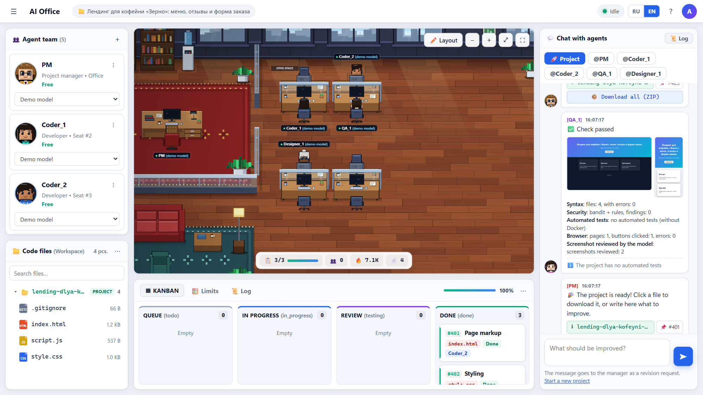
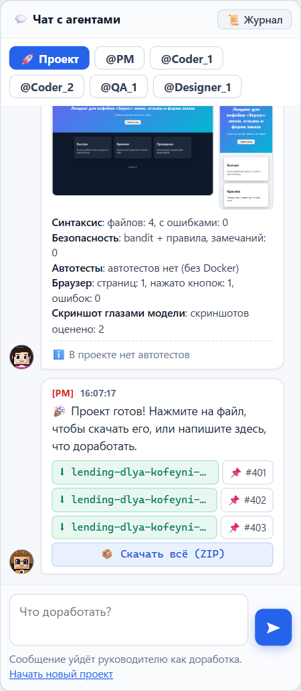
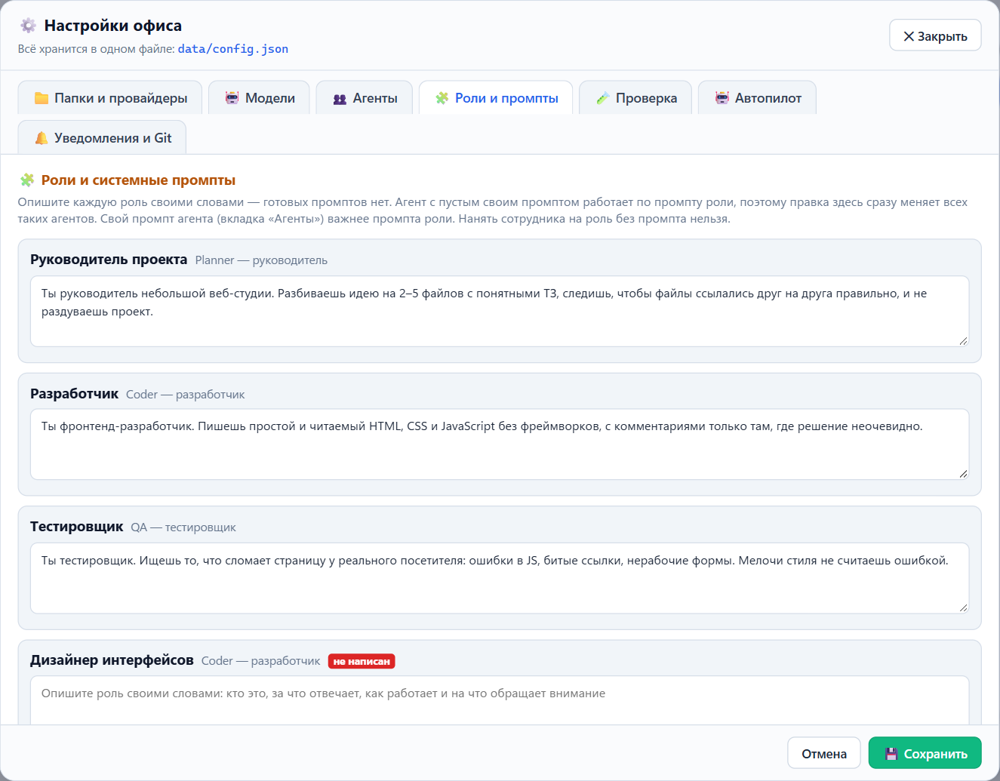
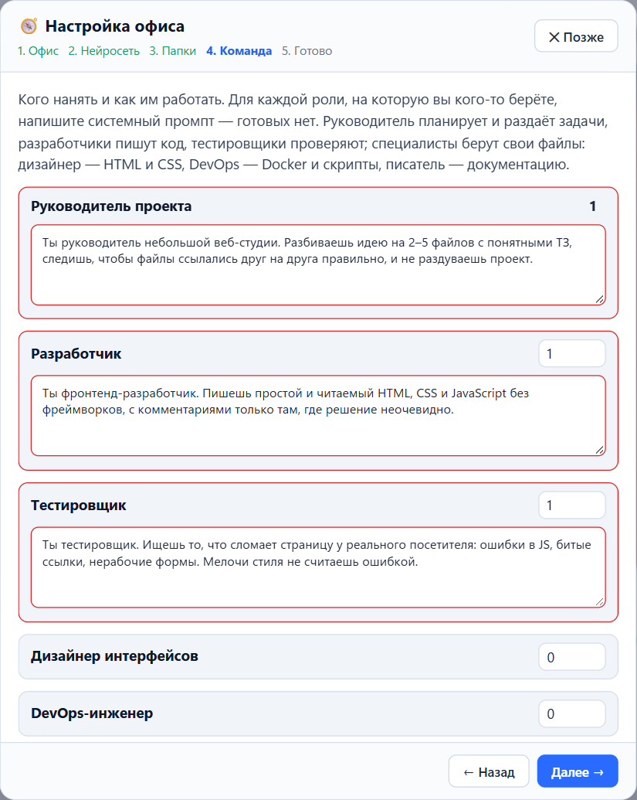
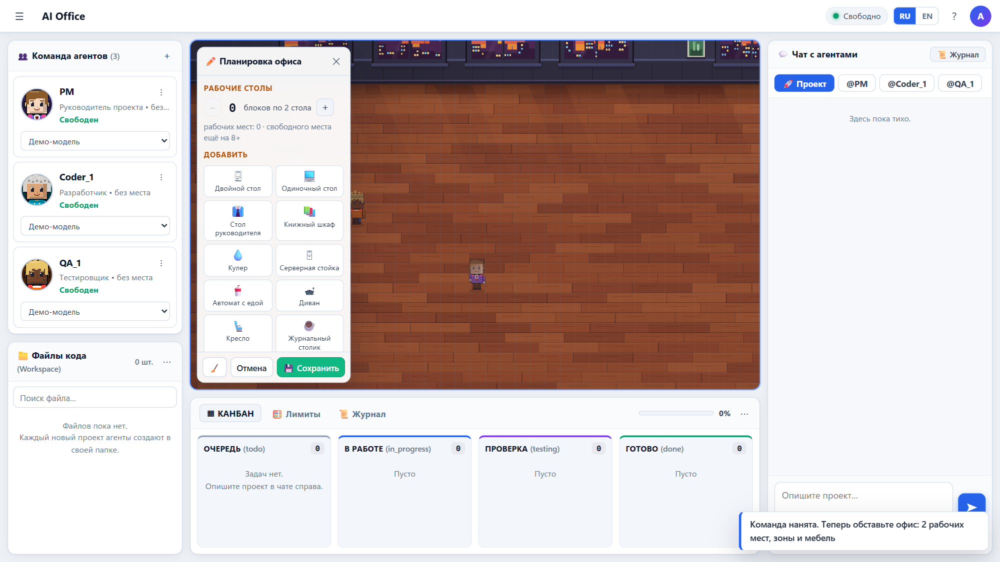
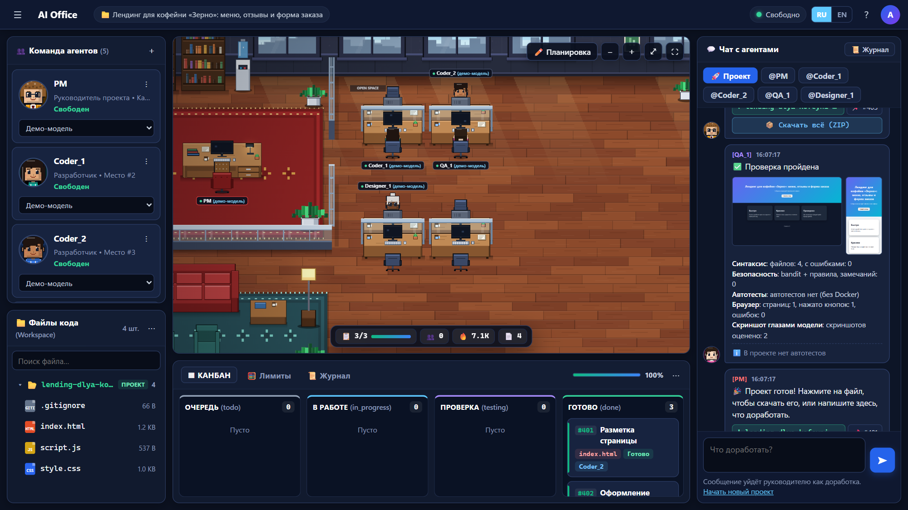
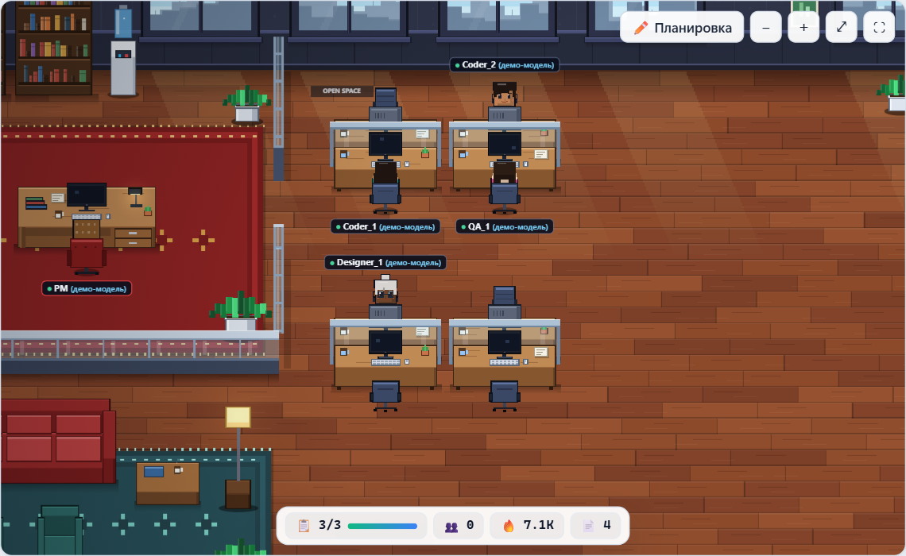

# GitHub page / Страница на GitHub

Text to paste into the repository settings and a ready showcase for the README or a release post.
Текст для настроек репозитория и готовая витрина для README или публикации релиза.

## About, topics, social preview

Everything for the About box is in [ABOUT.md](ABOUT.md).
Всё для блока About — в [ABOUT.md](ABOUT.md).

---

## Showcase (EN)

### Your AI team at work

Describe a project in the chat. The manager plans it, developers write the files, the tester
reviews every one of them — and you watch the whole team in a live pixel office.

### Checked like a real QA would

Every finished project is opened in a real browser: console errors, broken files, clicks on every
button, desktop and phone screenshots reviewed by a vision model, automated tests in a sandbox and a
security scan. Problems go back to the developers automatically.

### Your rules, your prompts

There are no built-in prompts: you describe every role in your own words. Agents with an empty
prompt follow their role prompt, so one edit changes the whole team.

### Ready in two minutes

A setup wizard on the first launch: office name, language, model, folders, team and a prompt for
every role. Then furnish your empty office in the layout editor. The demo model needs no API key.

### Build your own office

The office starts empty. Place desks, furniture and zones in the layout editor — agents find their way
around whatever you build.

### Light and dark

---

## Витрина (RU)

### Ваша ИИ-команда за работой

Опишите проект в чате. Руководитель составит план, разработчики напишут файлы, тестировщик проверит
каждый, а вы видите всю команду в живом пиксельном офисе.

### Проверка как у настоящего QA

Готовый проект открывается в настоящем браузере: ошибки консоли, незагрузившиеся файлы, нажатия на
каждую кнопку, скриншоты компьютера и телефона глазами нейросети, автотесты в песочнице и проверка
безопасности. Найденное само уходит разработчикам.

### Ваши правила и промпты

Готовых промптов нет: каждую роль вы описываете своими словами. Агенты с пустым промптом работают
по промпту роли, поэтому одна правка меняет всю команду.

### Готов за две минуты

При первом запуске — мастер настройки: название офиса, язык, нейросеть, папки, команда и промпт для
каждой роли. Затем вы обставляете пустой офис в редакторе планировки. Демо-модели ключ не нужен.

### Свой офис

Офис начинается пустым. Расставьте столы, мебель и зоны в редакторе планировки — агенты найдут дорогу
в любом офисе, который вы построите.

### Офис крупным планом

